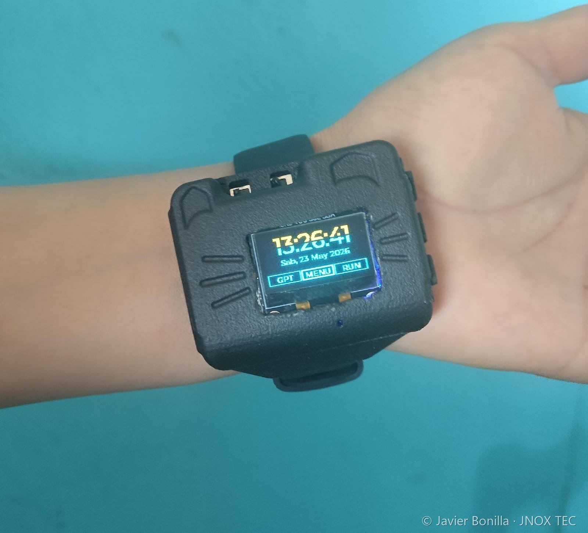
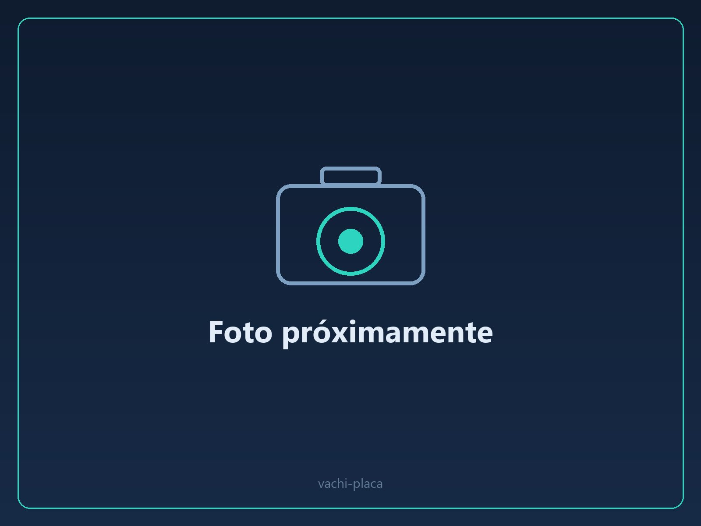
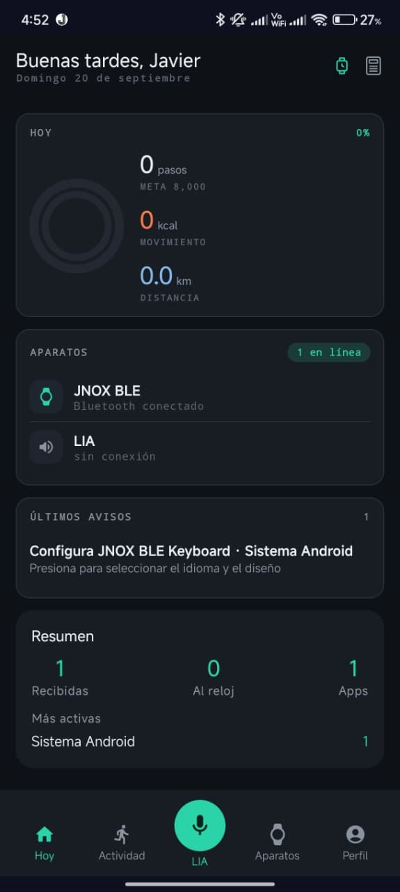

  

# Javier Bonilla Flores

**Diseño de PCB · Carcasas 3D · Firmware embebido.** Estudiante de Ingeniería Mecatrónica en la PUCP (Lima, Perú). Diseño, fabrico, ensamblo y programo mis propios dispositivos electrónicos.

> Este repositorio muestra **resultados**: fotos, especificaciones, decisiones de diseño y el estado real de cada proyecto.
> El código, los esquemáticos y los archivos de fabricación **no son públicos**. Los enseño en entrevista (ver [qué puedo mostrar](#qué-puedo-mostrar-en-una-entrevista)).

---

## De un vistazo

| PCB de 2 y 4 capas | 5 placas V3 | 4 productos con carcasa impresa | 1 unidad vendida |
|:---:|:---:|:---:|:---:|
| Diseñadas en EasyEDA Pro y fabricadas en JLCPCB | Soldadas a mano, componentes SMD 0603 | Nylon PA12 y PLA, diseñadas en Autodesk Inventor | Sin fallas ni quejas desde la entrega |

---

## Proyectos

<table>
  <tr>
    <td width="33%" valign="top" align="center">
       
      <b><a href="proyectos/jnox-watch-v4.md">JNOX Watch V4</a></b> 
      Reloj con pantalla AMOLED táctil. Mi primera PCB de 4 capas y carcasa sellada en PA12. 
      <i>PCB y carcasa fabricadas; ensamblaje en curso.</i>
    </td>
    <td width="33%" valign="top" align="center">
       
      <b><a href="proyectos/jnox-watch-v3.md">JNOX Watch V3</a></b> 
      Reloj inteligente con GPS, IMU, micrófono y asistente de voz. PCB de 2 capas y carcasa en PA12. 
      <i>Funcional. 1 unidad vendida.</i>
    </td>
    <td width="33%" valign="top" align="center">
       
      <b><a href="proyectos/jnox-sci-v0.md">JNOX SCI v0</a></b> 
      Calculadora gráfica programable con teclado táctil, microSD y Lua. Carcasa de 3 piezas en PLA. 
      <i>Prototipo funcional.</i>
    </td>
  </tr>
  <tr>
    <td width="33%" valign="top" align="center">
       
      <b><a href="proyectos/lnox-v0.md">LNOX v0</a></b> 
      Asistente de voz tipo Alexa vinculado al reloj y a la app. Carcasa compacta en PA12. 
      <i>Prototipo funcional.</i>
    </td>
    <td width="33%" valign="top" align="center">
       
      <b><a href="proyectos/vachi-v0.md">VACHI v0</a></b> 
      PCB de 4 capas con etapa de potencia para tres servomotores, para un proyecto de emprendimiento. 
      <i>Fotos en desarrollo.</i>
    </td>
    <td width="33%" valign="top" align="center">
       
      <b><a href="proyectos/jnox-app.md">JNOX App</a></b> 
      Aplicación Android del reloj: notificaciones, rutas de GPS y asistente de voz. 
      <i>En revisión en Google Play.</i>
    </td>
  </tr>
</table>

Además: [otros trabajos](proyectos/otros-trabajos.md) (kit de clamshells, amplificador analógico, planos para corte láser).

---

## Cómo diseño

1. **Requisitos y selección de componentes**: consumo, tamaño, disponibilidad y costo antes de dibujar nada.
2. **Esquemático y layout** en EasyEDA Pro, con reglas de apilado, retorno de corriente, desacoplo y antena. [Mis criterios de diseño](proyectos/criterios-de-diseno.md).
3. **Fabricación** de PCB y carcasa en JLCPCB (PCB 2 y 4 capas; nylon PA12 sinterizado y resina SLA).
4. **Ensamblaje y soldadura** propios de los componentes SMD.
5. **Carcasa** en Autodesk Inventor: tabla de apilado en Z, holguras, sellado y diseño para impresión 3D.
6. **Firmware** (ESP32-S3) y apps de apoyo, con ayuda de herramientas de IA (ver [uso de IA](#uso-de-ia)).
7. **Pruebas y mejora continua**: cada versión corrige lo que enseñó la anterior (V2 → V3 → V4).

## Uso de IA

El diseño de las PCB y de las carcasas (selección de componentes, esquemático, layout y CAD) es mío. El código de las apps y parte del firmware de los dispositivos lo desarrollé con ayuda de herramientas de IA. Prefiero decirlo de forma explícita.

## Herramientas

## Evidencias públicas

- Short del SCI v0 reproduciendo vídeo: [youtube.com/shorts/5ruWCYLRwf0](https://www.youtube.com/shorts/5ruWCYLRwf0)
- Ensamblaje y soldadura SMD del JNOX V3 (vídeo): [canal de YouTube](https://www.youtube.com/@Bonijaviere)
- Avances de los proyectos: [LinkedIn](https://www.linkedin.com/in/bonijaviere/)

## Qué puedo mostrar en una entrevista

Por cuidar mis diseños, no publico el código, los esquemáticos ni los archivos de fabricación. En una entrevista puedo enseñar en vivo:

- El proyecto de EasyEDA y los modelos de Inventor abiertos, con su historial de versiones.
- Los dispositivos funcionando y las placas fabricadas.
- El historial de pedidos de fabricación y el historial de commits de los repositorios privados.

## Propiedad intelectual

© 2026 Javier Bonilla Flores. Todos los derechos reservados. Las imágenes y los textos de este repositorio no pueden copiarse, modificarse ni usarse con fines comerciales sin permiso por escrito. Se permite compartir los enlaces. Detalle en [LICENSE](LICENSE).

JNOX, JNOX Watch, LNOX, LIA y SCI son nombres de proyectos propios.
