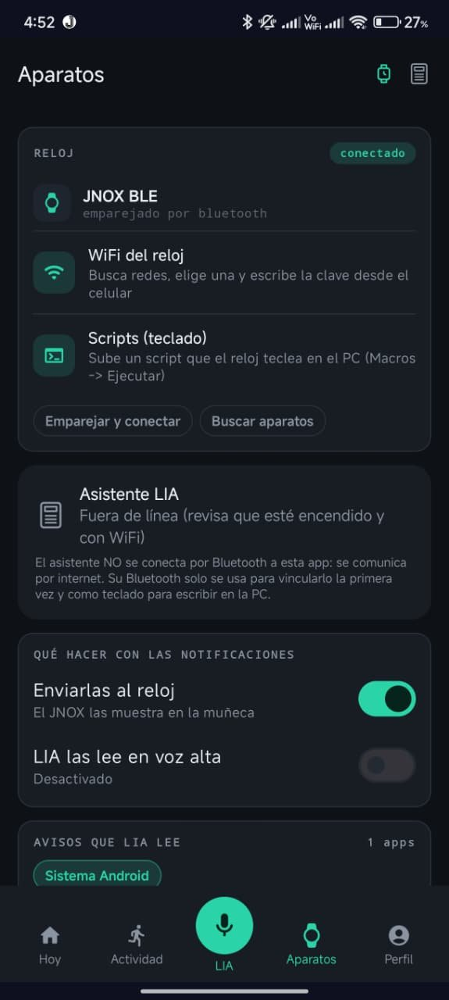
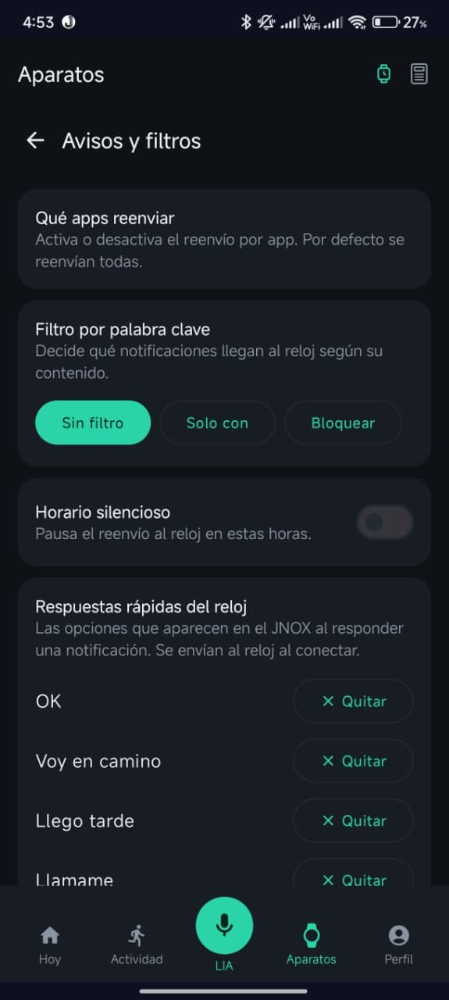

# JNOX App

*Aplicación Android para el reloj JNOX y el asistente LIA · Kotlin y Jetpack Compose*

  
  
  

Centro de control del reloj en el teléfono. Reenvía al reloj las notificaciones del teléfono, permite responderlas desde la muñeca, muestra la actividad y las rutas sobre el mapa, y configura el reloj y el asistente de voz.

## Qué hace

- **Notificaciones al reloj por Bluetooth LE**, con respuesta directa desde el reloj, filtros por aplicación y por palabra clave, horario silencioso y respuestas rápidas editables.
- **Actividad**: pasos del día y rutas de GPS dibujadas sobre mapa de OpenStreetMap.
- **Configuración del reloj** desde el teléfono: elegir una red Wi-Fi y enviar la clave por Bluetooth, y subir scripts de teclado.
- **Modo estudio**: el reloj activa el «No molestar» del teléfono.
- **Asistente LIA** y cuenta de usuario con Firebase Auth.

## Ficha técnica

| | |
|---|---|
| Plataforma | Android 8.0 o superior, apuntando a API 36 |
| Tecnologías | Kotlin, Jetpack Compose, BLE, OkHttp, osmdroid, Firebase Auth |
| Servicio en la nube | Cloudflare Workers (no público) |

## Estado

En revisión en Google Play; por ahora está disponible solo para los verificadores. El código de la app lo desarrollé con ayuda de herramientas de IA.

[← Volver al portafolio](../README.md)
