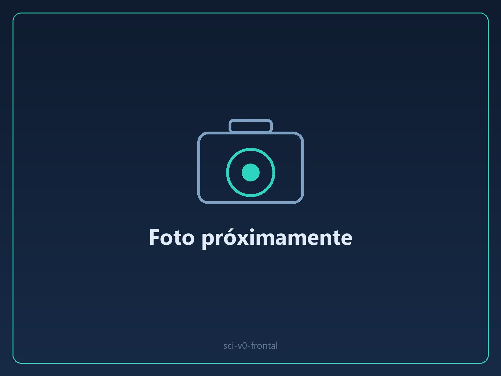
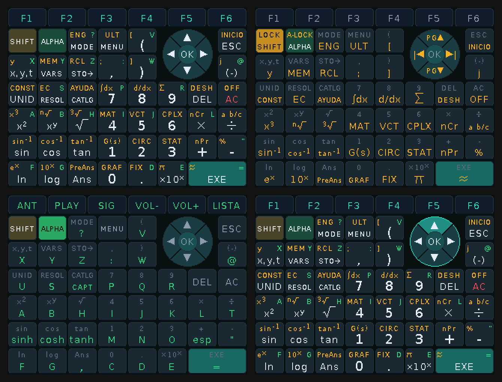
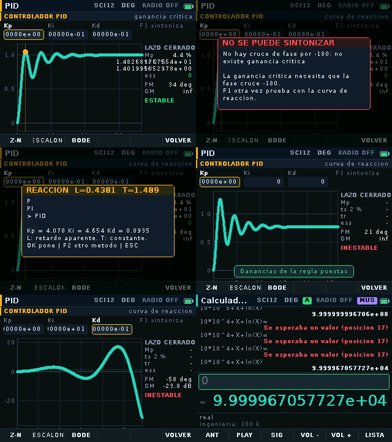

# JNOX SCI v0

*Calculadora gráfica programable · hardware del JNOX V3 · carcasa de 3 piezas en PLA*

Calculadora de ingeniería con pantalla y teclado táctiles de 54 teclas, microSD, audio y un intérprete de Lua para escribir programas. La v0 es una **demostración sobre la placa del JNOX V3**: sin rediseñar la PCB, con dos módulos de pantalla añadidos.

[Short en YouTube mostrando la reproducción de vídeo](https://www.youtube.com/shorts/5ruWCYLRwf0)

## Ficha

| | |
|---|---|
| Hardware base | Placa del JNOX V3 (ESP32-S3 N16R8). Se retiran el GPS y el reproductor de música para liberar sus pads |
| Pantalla y teclado | Dos módulos táctiles ILI9341: uno de 2,8" para la pantalla y otro de 2,4" con el teclado dibujado |
| Almacenamiento | microSD |
| Audio | Conversor I2S PCM5102A con salida de 3,5 mm |
| Carcasa | 3 piezas diseñadas en Autodesk Inventor e impresas en PLA en una Bambu Lab A1 propia |
| Software | 416 funciones y 98 pantallas (unidades, matrices, control, gráficas 2D y 3D), intérprete de Lua y app de escritorio con nube para enviar archivos, PDF y vídeo (código no público) |

## Mi aporte

- Integración del hardware: con un solo V3, sus 11 GPIO libres alcanzan para las dos pantallas con táctil y la microSD, conservando los tres pulsadores.
- Diseño de la carcasa en tres piezas e impresión propia.
- Firmware, simulador y app de escritorio.
- Estudio propio de costos y mercado para llevarlo a una versión con placa propia.

## Cómo lo valido

El cálculo se comprueba con pruebas automáticas, sin necesidad del aparato:

- 416 ejemplos del catálogo ejecutados y 98 pantallas dibujadas.
- 993 comprobaciones de identidades matemáticas y valores exactos de tabla.
- 125 expresiones de control evaluadas por el simulador y por el núcleo del firmware compilado en el PC, con los mismos resultados.
- 41 programas de Lua comparados contra el intérprete del aparato.
- 16 758 pulsaciones y 39 200 toques sin que ninguna pantalla se cuelgue.

## Estado

Prototipo funcional. El siguiente paso es una versión con placa propia (diseño final en curso).

[← Volver al portafolio](../README.md)
