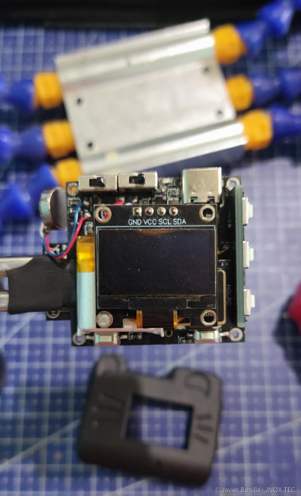
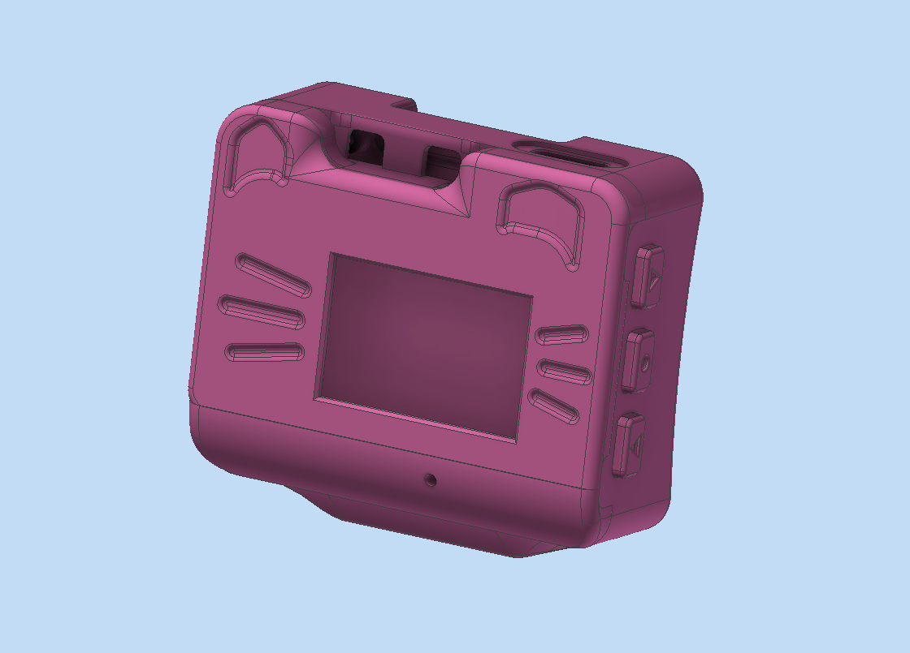

# JNOX Watch V3

*Reloj inteligente · PCB de 2 capas · carcasa en nylon PA12*

Reloj de muñeca con GPS propio, IMU, micrófono, vibrador y asistente de voz. Es la placa que después reutilicé en el LNOX, el SCI v0 y otros prototipos: **un solo diseño, varios usos**.

## Ficha

| | |
|---|---|
| PCB | 2 capas, diseñada en EasyEDA Pro y fabricada en JLCPCB. Planos de tierra y anchos de pista variables según la señal. |
| Procesador | ESP32-S3 N16R8 |
| Sensores y salidas | OLED de 0,96" (128×64), IMU BMI160, micrófono digital I2S, módulo GPS, vibrador, 3 pulsadores |
| Energía | Batería LiPo de 220 mAh, carga por USB-C |
| Carcasa | Nylon PA12 barnizado con acrílico, diseñada en Autodesk Inventor |
| Ensamblaje | 5 unidades soldadas a mano (SMD 0603) |
| Software | Firmware en C++ con LVGL, BLE y ESP-NOW, y app Android propia (código no público) |

## Mi aporte

- Diseño del esquemático y de la PCB de 2 capas: circuito de carga, regulación, planos de tierra y ruteo con anchos de pista según cada señal.
- Cambio del zumbador de la V2 por un vibrador, reutilizando el mismo circuito de control.
- Soldadura a mano de las 5 placas, con componentes SMD 0603.
- Carcasa a medida (con temática de gato) para la persona que compró la unidad; las correas se compraron aparte.
- Firmware y app Android de control.

## De dónde viene

| Versión | Fecha | Qué cambió |
|---|---|---|
| V0 y V1 | dic. 2024 | Prototipos en protoboard con ESP32 y asistente de voz. |
| V2 | oct. 2025 | Primera PCB: ESP32-S3 N16R8, micrófono, zumbador, pantalla, regulador, 5 pulsadores, todo SMD 0603. Sin circuito de carga y sin carcasa. |
| **V3** | **mar. 2026** | Circuito de carga integrado, regulación más eficiente, vibrador, USB-C para cargar y programar, planos de tierra y mejor ruteo. |
| V4 | sept. 2026 | [PCB de 4 capas con AMOLED y carcasa sellada](jnox-watch-v4.md). |

## Decisiones de diseño

- **El nylon PA12 absorbe humedad**, así que la carcasa lleva barniz acrílico. Resiste salpicaduras leves; no es un reloj sumergible.
- **Planos de tierra y pistas de ancho variable según la señal**, como mejora del ruteo respecto a la V2.
- **Hardware reutilizable**: la placa expone pads de los GPIO libres, lo que permitió convertirla en un parlante y en una calculadora sin rediseñarla.

## Estado

Funcional. Una unidad vendida, que sigue en uso sin fallas ni quejas. Las demás placas se usan como base del [LNOX](lnox-v0.md), el [SCI v0](jnox-sci-v0.md) y otros prototipos.

## Evidencia

- Vídeo del ensamblaje y la soldadura SMD, en el [canal de YouTube](https://www.youtube.com/@Bonijaviere).

[← Volver al portafolio](../README.md)
