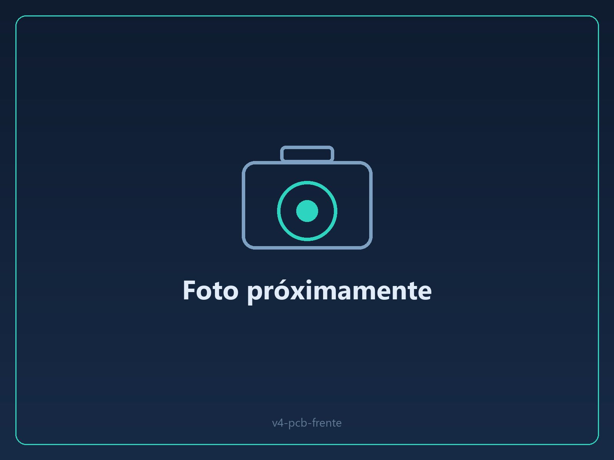
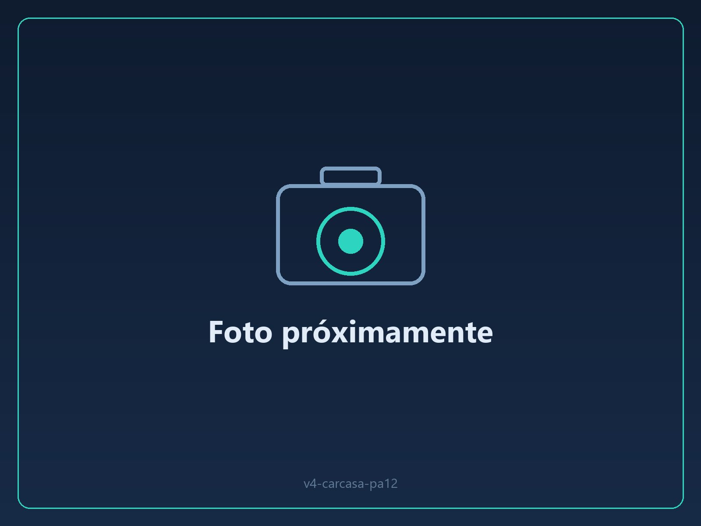

# JNOX Watch V4

*Reloj AMOLED táctil · primera PCB de 4 capas · carcasa sellada en nylon PA12*

Reloj de muñeca con pantalla AMOLED táctil, GPS, IMU de 9 ejes, salida de audio y microSD, dentro de una caja de unos 5 × 4,6 × 2,3 cm. Es el salto de la [V3](jnox-watch-v3.md): de 2 a 4 capas, de USB-C a pines pogo y de una carcasa abierta a una sellable.

## Ficha

| | |
|---|---|
| PCB | 4 capas (señal / masa continua / alimentación / señal), diseñada en EasyEDA Pro y fabricada en JLCPCB |
| Procesador | ESP32-S3-WROOM-1 N16R8 |
| Pantalla | AMOLED de 2,01" (240×296), táctil, por interfaz QSPI |
| Sensores | IMU de 9 ejes BNO085, GPS multiconstelación M10 con antena cerámica, micrófono MEMS digital |
| Audio | Amplificador clase D MAX98357A (encapsulado BGA) y altavoz |
| Almacenamiento | microSD |
| Energía | LiPo de 600 mAh, cargador con *power-path* y regulación de bajo consumo; carga por pines pogo magnéticos |
| Carcasa | Nylon PA12 sinterizado, botón en resina SLA (Imagine Black), sellada con silicona |
| Tamaño | ≈ 5 × 4,6 × 2,3 cm |
| Resistencia al agua | Diseñada para IP67. **Es un cálculo teórico; la validación experimental está pendiente.** |

## Mi aporte

- Diseño completo de la PCB de 4 capas: selección de componentes, esquemático, apilado, ruteo, antena, alimentación y carga.
- Diseño de la carcasa y del mecanismo del botón en Autodesk Inventor, con la tabla de apilado en Z, las holguras y el sellado.
- Pedido de fabricación de la PCB, la carcasa en PA12 y el botón en resina SLA.
- Adaptación del firmware de la V3 al hardware nuevo.

## Decisiones de diseño

- **Pines pogo en lugar de USB-C.** Sin conector abierto, la caja se puede sellar por completo con silicona. El USB nativo del chip va a los contactos pogo, pensado para programar el reloj con la caja cerrada (se comprobará al terminar el ensamblaje).
- **Botón en resina SLA.** Más precisión y menos fricción que el PA12 sinterizado en una pieza tan pequeña.
- **Antena del módulo ESP32-S3 fuera del borde de la placa**, con cobre libre debajo en las 4 capas.
- **La batería se eligió por grosor y huella**, no solo por capacidad: en un reloj lo que adelgaza la caja son los milímetros, no los mAh.
- **Una sola pantalla manda la huella.** La caja se dimensionó desde el módulo AMOLED y su cola flexible, que exige un radio de doblez mínimo.

## Estado

PCB y carcasa fabricadas (pedido del 2 de septiembre de 2026). El ensamblaje está en curso. El firmware está adaptado de la V3 y se validará sobre el hardware final; el sellado IP67 también se comprobará una vez armado.

[← Volver al portafolio](../README.md)
